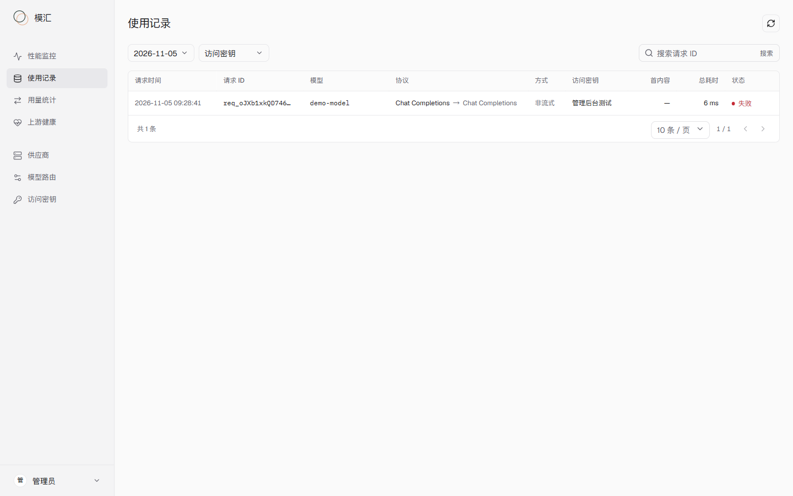
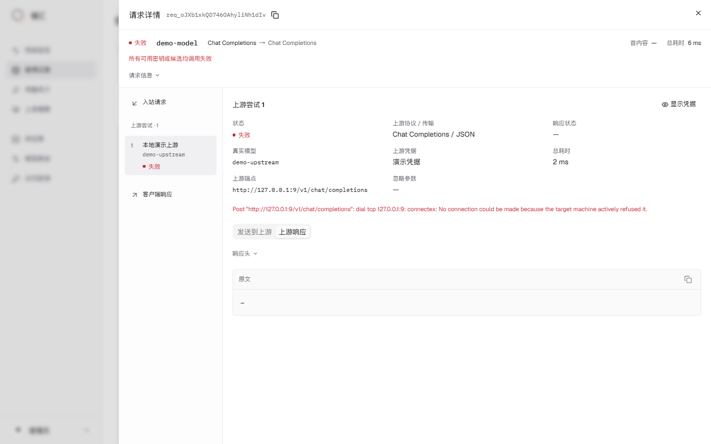
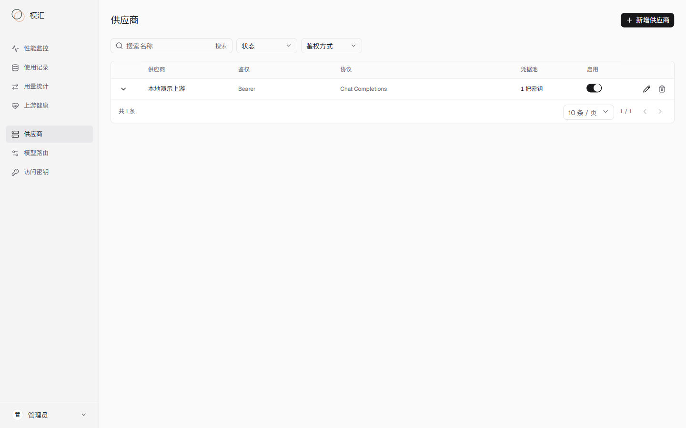
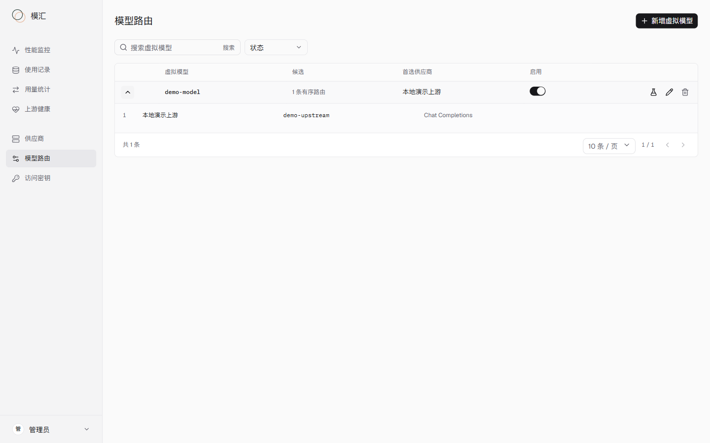

<p align="center">
  
</p>

# 模汇（model-confluence）

模汇是一款面向个人私有部署的 AI 协议网关，为 Codex、Claude Code 和 OpenAI 兼容客户端提供统一入口，在 OpenAI Chat Completions、OpenAI Responses 与 Anthropic Messages 之间转换协议，并记录请求、上游尝试、Token 用量和延迟。

项目使用 Go、React 和 TypeScript，SQLite 持久化配置与日志。正式构建内嵌管理后台，运行只需要一个可执行文件和一个数据目录。

## 核心能力

- 同协议透传，跨协议转换文本、SSE、图片输入和客户端工具调用。协议入口与能力边界见 [需求与设计](docs/requirements.md#4-对外-api)。
- 通过虚拟模型、有序候选和供应商密钥池管理路由，支持故障切换、路由预演和兼容性验证。
- 在管理后台查看实时路由、请求与上游尝试、Token 用量和延迟，按需比较转换差异或重放请求。操作见 [管理后台与客户端调用](docs/operations.md#管理后台与客户端调用)。
- 支持普通 API Key 供应商、Codex OAuth 和实验性的 Antigravity OAuth。账号接入见 [浏览器登录](docs/operations.md#浏览器登录)。

## 下载与运行

从 [GitHub Releases](https://github.com/Sanjeever/model-confluence/releases/latest) 下载对应平台的版本并解压。首次初始化空数据库需要提供管理员密码。

macOS / Linux：

```bash
chmod +x model-confluence
MODEL_CONFLUENCE_ADMIN_PASSWORD="请替换为管理员密码" ./model-confluence --listen 127.0.0.1:8080 --data-dir ./data
```

Windows PowerShell：

```powershell
$env:MODEL_CONFLUENCE_ADMIN_PASSWORD = "请替换为管理员密码"
./model-confluence.exe --listen 127.0.0.1:8080 --data-dir ./data
```

访问 <http://localhost:8080> 登录管理后台，然后按 [客户端配置步骤](docs/operations.md#管理后台与客户端调用)创建访问密钥和模型路由。

数据库及日志包含完整凭据。部署、升级和远程访问见 [运行与开发](docs/operations.md)。

## 本地开发

工具版本、前后端启动命令和单文件构建步骤见 [开发与构建](docs/operations.md#开发与构建)。

## 项目结构与文档入口

| 位置 | 职责 |
| --- | --- |
| `cmd/model-confluence`、`internal/app` | 程序生命周期、HTTP 装配与安全头 |
| `internal/config`、`internal/httpx` | 启动配置、JSON 工具与可信客户端 IP |
| `internal/admin` | 管理 API、管理员会话、CSRF 与登录限速 |
| `internal/gateway` | 入站鉴权、路由执行、上游代理与日志收尾 |
| `internal/protocol` | 三协议请求、响应、usage 与 SSE 转换 |
| `internal/codex`、`internal/antigravity`、`internal/oauthlogin` | 订阅后端适配、OAuth 凭据与浏览器登录会话 |
| `internal/store` | SQLite schema、迁移、配置、路由与日志查询 |
| `web/src`、`internal/webui` | 管理后台源码与静态资源托管 |

- 产品边界、架构取舍及实现差距见 [需求与设计](docs/requirements.md)。
- 部署、配置、调用示例和发布流程见 [运行与开发](docs/operations.md)。
- 版本变化与升级说明见 [更新日志](docs/releases)及 [GitHub Releases](https://github.com/Sanjeever/model-confluence/releases)。
- Coding Agent 的工作约定见 [AGENTS.md](AGENTS.md)。

## 界面预览

截图使用演示数据。请求详情展示上游不可达时的排障流程。

### 使用记录



### 请求详情



### 供应商管理



### 模型路由



## 许可证

本项目使用 [MIT License](LICENSE)。
